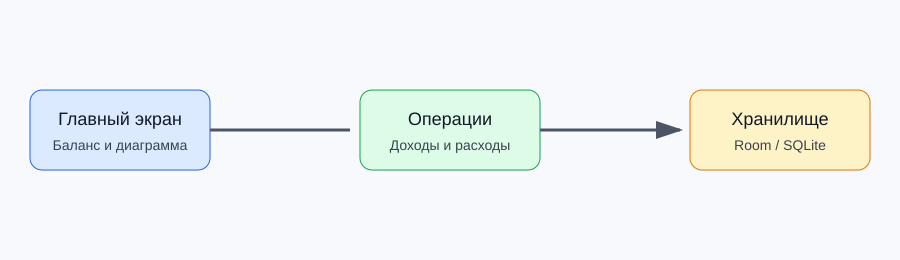

# Документация FinanceTracker

FinanceTracker — Android-приложение для учёта доходов, расходов и счетов пользователя.
Документация предназначена для пользователя приложения и разработчика, который выполняет сборку и сопровождение проекта.

## Основные возможности

- добавление доходов и расходов;
- ведение нескольких счетов;
- просмотр истории операций;
- отображение баланса;
- просмотр соотношения доходов и расходов на диаграмме.

## Навигация

1. [Быстрый старт](quick-start.md)
2. [Установка и настройка](installation.md)
3. [Руководство пользователя](user-guide.md)
4. [Справочная информация](reference.md)
5. [Устранение неисправностей](troubleshooting.md)

> Важно: приложение хранит операции локально на Android-устройстве.
